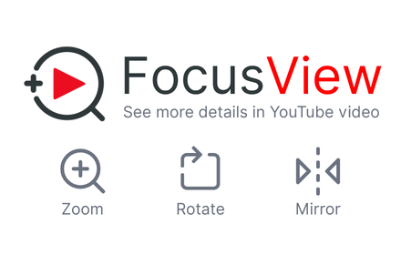

# FocusView

Reveal video details in YouTube videos.

FocusView adds smooth zoom, rotate, and mirror controls to YouTube videos in your browser.

Best for:

- concerts and livestreams
- sports clips
- lectures and tutorials
- any video where you want a closer look

[Watch the YouTube demo](https://www.youtube.com/watch?v=x4EzsXcOo_A)

[Download from the Chrome Web Store](https://chromewebstore.google.com/detail/jbdndcjclbghkmbiehjigaapembpbgdb?utm_source=github)

[Download from the Apple App Store](https://apps.apple.com/us/app/focusview-zoom-for-youtube/id6786108302)

## Preview




## Features

- Press `Alt/Option + Shift + Z` to turn zoom mode on or off.
- Scroll to zoom videos from `100%` to `500%` around the mouse pointer.
- Long-press and drag to move around a zoomed video.
- Rotate videos by `90°`, `180°`, or `270°`.
- Mirror videos horizontally.

## Privacy And Permissions

FocusView does not collect data, does not track users, and does not send anything to external servers. All transforms happen locally in your browser.

The Safari wrapper validates bundled resources and messages, surfaces setup errors, and does not log or echo native messages.

The extension only runs on YouTube pages:

```json
"matches": ["https://www.youtube.com/*"]
```

It does not request browser permissions for storage, history, accounts, analytics, or network access.

See [PRIVACY.md](PRIVACY.md) for the full privacy policy.

## Contact

For support, feedback, or bug reports, email `kodin.gai.apps@gmail.com`.

## Release Notes

Latest submitted Chrome release: `1.1.8` (review pending).

See [CHANGELOG.md](CHANGELOG.md).

## Product Quality

See the [2026-09-02 product maturity audit](docs/product-audit-2026-09-02.md) for the current UX, accessibility, architecture, testing, and release roadmap.

## Chrome Web Store Listing Translations

All 55 Chrome-supported locale summaries and full listing descriptions are maintained in [docs/store-listing](docs/store-listing/README.md). Chrome 1.1.8 includes localized package summaries; product names and extension controls remain in English. English regional variants share the English copy. Version 1.1.7 was confirmed published in the developer dashboard on 2026-11-11. All 55 full descriptions were verified after reloading the developer dashboard, and version 1.1.8 was submitted for review on 2026-11-11 with automatic publication after approval. The public version remains 1.1.7 until approval; see the linked release record.

The four English listing descriptions share the approved revised introduction and use cases, including screen fitting and black bars. This local copy update has not been applied to the store; package summaries and other languages are unchanged.
