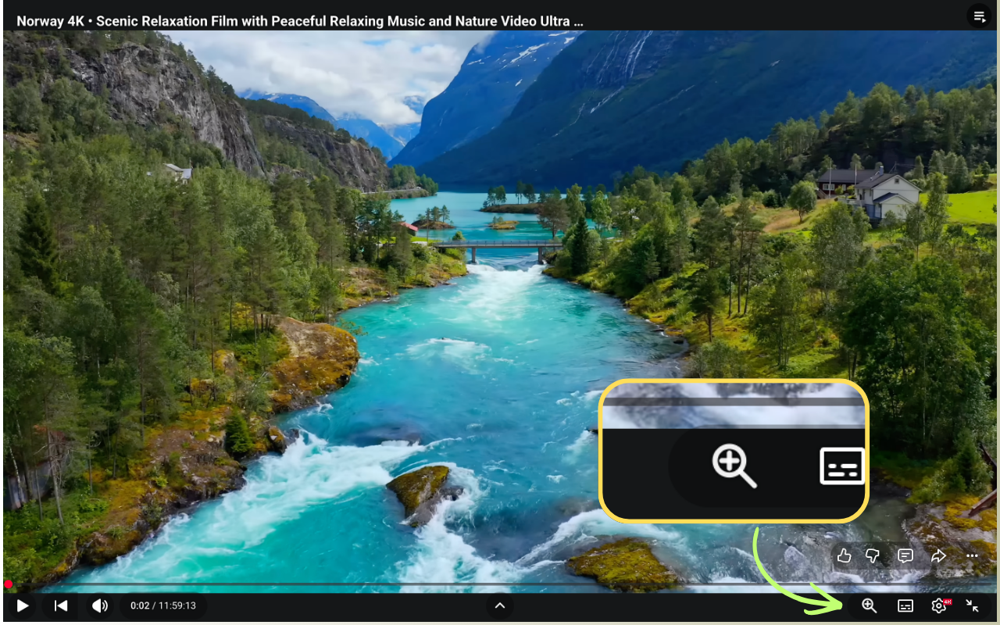
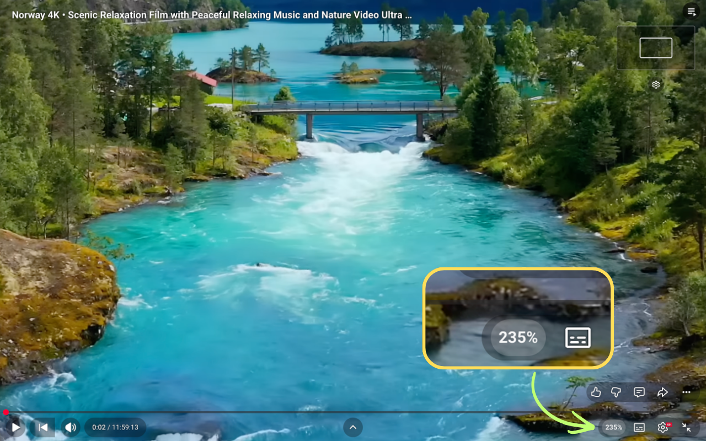

# FocusView

Reveal video details in YouTube videos.

FocusView adds smooth zoom, rotate, and mirror controls to YouTube videos in your browser.

Best for:

- concerts and livestreams
- sports clips
- lectures and tutorials
- any video where you want a closer look

[Watch the YouTube demo](https://www.youtube.com/watch?v=x4EzsXcOo_A)

[Download from the Chrome Web Store](https://chromewebstore.google.com/detail/jbdndcjclbghkmbiehjigaapembpbgdb?utm_source=github)

[Download from the Apple App Store](https://apps.apple.com/us/app/focusview-zoom-for-youtube/id6786108302)

## Preview






## Features

- Press `Alt/Option + Shift + Z` to turn zoom mode on or off.
- Scroll to zoom videos from `100%` to `500%` around the mouse pointer.
- Long-press and drag to move around a zoomed video.
- Rotate videos by `90°`, `180°`, or `270°`.
- Mirror videos horizontally.
- Every 10 times you turn on zoom mode, a compact, branded popup with the FocusView logo invites you to “Rate FocusView” or “Buy me a coffee”. The popup follows your system’s light or dark appearance. Close it with × or Esc; choosing either link stops future reminders. The footer places “Already supported?” and “Don’t remind me again” on one line, using the same secondary text color as the description for the label and a blue, non-underlined button. For now, clicking that button closes the popup, resets the count, and switches all future reminders to every 20 activations; permanent dismissal for this action is deferred. Counts and this preference are shared across tabs and browser restarts on this device.

## Privacy And Permissions

FocusView does not collect data, does not track users, and does not send anything to external servers. All transforms happen locally in your browser.

The Safari wrapper validates bundled resources and messages, surfaces setup errors, and does not log or echo native messages.

The extension only runs on YouTube pages:

```json
"matches": ["https://www.youtube.com/*"]
```

The only browser permission is local storage, used for the zoom mode activation count, reminder interval, and whether support reminders have been stopped. These values stay on your device. It does not request permissions for history, accounts, analytics, or network access.

See [PRIVACY.md](PRIVACY.md) for the full privacy policy.

## Support

Enjoying FocusView? [Buy me a coffee](https://ko-fi.com/kodingai) to support continued maintenance and development.

The in-player reminder says: “Thanks for watching with FocusView! Your support helps me keep making it better.”

Support is entirely optional. Thank you for using FocusView!

## Contact

For support, feedback, or bug reports, email `kodin.gai.apps@gmail.com`.

## Release Notes

Latest submitted Chrome release: `1.1.8` (review pending).

See [CHANGELOG.md](CHANGELOG.md).
