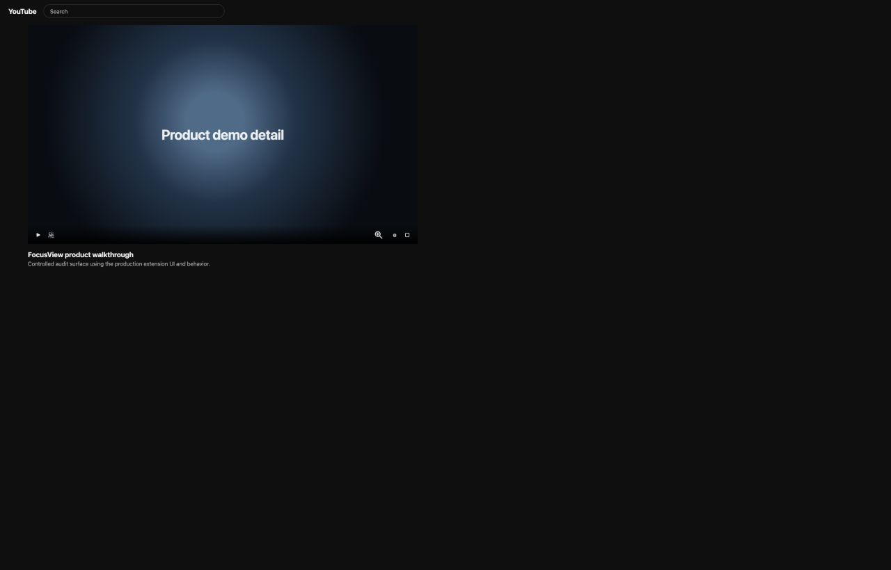
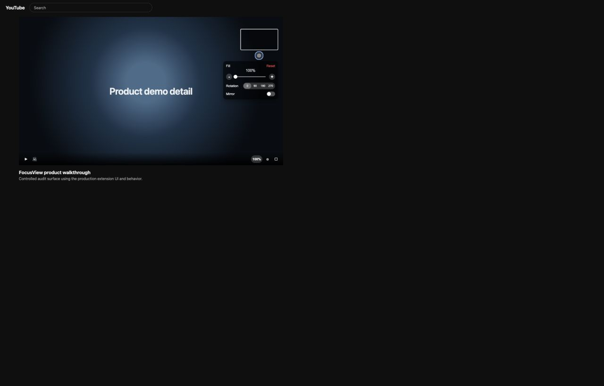
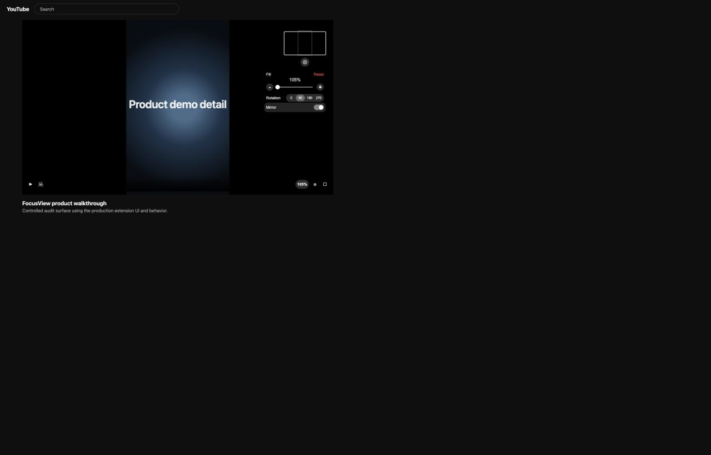

# FocusView Product Maturity Audit

Date: 2026-09-02
Version reviewed: 1.1.6
Scope: Chrome/Edge extension, Safari Web Extension wrapper, popup, YouTube player controls, runtime architecture, performance, accessibility, testing, release process, privacy, and documentation.

## Executive Summary

FocusView is already a focused, privacy-respecting utility with strong transform math and careful high-frequency input handling. The core is release-capable, but the product is not yet operationally mature: browser integration is not automatically tested, the main runtime is a 1,622-line module with 37 mutable module-level variables, Safari runtime copies are maintained manually, and several control semantics are incomplete for assistive technology.

Overall maturity: **7.1/10 — polished utility, not yet a mature product system**.

There are no P0 security or data-loss findings. The next release should prioritize accessibility, real-browser regression coverage, one-source cross-platform packaging, and removal of the 300 ms primary-control delay before adding new features.

| Area | Assessment | Evidence |
| --- | --- | --- |
| Core utility | Strong | Zoom, rotate, mirror, Fill, pan, minimap, reset, navigation reset, and fullscreen refresh are implemented. |
| Privacy/security | Strong | YouTube-only content script, no optional permissions, no network services, and guarded Safari native messages. |
| Performance | Good | Event-driven player discovery, batched animation updates, scoped wheel listeners, and 30 fps auxiliary UI updates. |
| UX | Good foundation | Compact native placement and clear direct manipulation; onboarding, responsiveness, and hidden gestures need work. |
| Accessibility | Needs improvement | Incorrect composite role, missing selected state, incomplete focus flow, and undersized targets. |
| Maintainability | Moderate risk | One large controller owns DOM, lifecycle, input, state, transforms, and compatibility workarounds. |
| Automated quality | Uneven | 107 tests pass and transform-state has 99.63% line coverage; the 1,622-line browser controller has no behavioral coverage. |
| Release operations | Needs improvement | Chrome ZIP and unsigned macOS build succeed, but no CI, release checklist gate, reproducibility check, or automated Safari resource generation exists. |

## Audit Method And Limits

The UX flow was exercised in the in-app browser using the production `content.js`, `transform-state.js`, and `overlay.css` against a controlled YouTube-compatible player surface. The popup used the production HTML and CSS. This validates FocusView's rendered UI and interaction state changes without relying on old screenshots.

The run did not validate live YouTube ads, account states, livestreams, theater/fullscreen transitions, Safari-specific event routing, Chrome Web Store installation, VoiceOver announcements, 200% zoom reflow, or long-session memory behavior. Accessibility findings are implementation risks, not a WCAG compliance claim. Live YouTube and signed Store builds still require a manual device/browser matrix.

## Flow Evidence

### 1. Toolbar popup — Healthy with onboarding gaps


Strengths: concise identity, clear shortcut, dark-mode support, direct feedback link, and no permission or account friction.

Risks: it does not explain that FocusView works only on standard YouTube watch pages, does not offer a first-success cue, and gives store rating space equal weight to task help. On unsupported pages the same instruction appears without a recovery path.

### 2. Player entry — Healthy



Strengths: the magnifier sits with native player controls, has a descriptive accessible name, and does not cover video content.

Risks: the icon alone is easy to miss for a first-time user. The double-click Reset gesture exists only in a tooltip and forces every pointer single-click to wait 300 ms.

### 3. Zoom mode — Healthy


Strengths: the icon becomes a percentage, pressed state is exposed, minimap and settings appear contextually, and wheel interception is limited to active Zoom mode.

Risks: mode activation is visually subtle and no live announcement confirms the change for screen-reader users. Minimap is named but has no semantic value describing the current viewport.

### 4. Settings and controls — Needs improvement



Strengths: controls are compact, logically grouped, use plain labels, and expose a keyboard-operable slider.

Risks:

- The container uses `role="menu"` while containing a textbox, slider, and ordinary buttons. This is not a valid menu interaction model.
- Rotation buttons expose no `aria-pressed` or radiogroup selection, so the chosen angle is invisible to assistive technology.
- The settings trigger exposes `aria-expanded` but not `aria-controls` or `aria-haspopup`, and Escape removes the panel without explicitly returning focus.
- Mirror is 36 × 20 px, and Fill/Reset have roughly 20 px-high hit areas; these are below the 24 × 24 px WCAG 2.2 target-size baseline unless an exception applies.
- Focus visibility relies mainly on browser defaults; the zoom text field removes its outline and only changes background.

### 5. Transformed state and recovery — Healthy



Strengths: zoom percentage, transform, minimap, mirror pressed state, and Reset update consistently. Reset returns to 100%, clears rotation/mirror/pan, closes settings, and turns Zoom mode off.

Risk: rotation selection remains visually styled only; its state is still absent from the accessibility tree after interaction.

## Prioritized Findings

### P1 — Complete before the next feature release

1. **Add real browser integration tests.** Build a minimal YouTube player fixture and test mount, Zoom mode, wheel zoom, slider keyboard behavior, rotation, mirror, player replacement, SPA navigation, fullscreen refresh, Reset, and listener cleanup. Keep a small manual matrix for current Chrome, Edge, and Safari against live YouTube.
2. **Correct accessibility semantics.** Use a non-modal settings popover/dialog or structured groups instead of `menu`; expose rotation as a radiogroup or pressed buttons; add trigger relationships, reliable focus return, visible focus styles, state announcements, and at least 24 × 24 px targets.
3. **Remove the 300 ms activation delay.** Make Zoom mode toggle immediately and keep Reset as the explicit settings action. Remove double-click Reset unless user evidence proves it is essential.
4. **Split the browser controller by responsibility.** Separate player lifecycle, input/gesture handling, view rendering, and orchestration while preserving `transform-state.js` as the pure domain layer. Introduce one controller-owned state object and explicit `mount`/`unmount` paths.
5. **Make shared runtime files single-source.** Generate or copy Chrome runtime resources into the Safari target during a verified build step. Fail CI on drift; keep only store-specific manifest/popup wording as intentional variants.
6. **Create a CI release gate.** On every change: syntax check, unit tests with coverage, DOM integration tests, Chrome ZIP build/inventory check, Safari unsigned build, version parity, clean-tree check, and artifact checksum.
7. **Improve unsupported/first-use guidance.** State “Open a standard YouTube video” in the popup, clarify that Shorts and embeds are unsupported, and provide a lightweight success hint on first activation without collecting usage data.

### P2 — Product hardening

1. Route-bind high-frequency listeners only while on a supported watch page; retain only the minimum SPA navigation listeners globally.
2. Test responsive player sizes, browser zoom at 200%, theater/fullscreen, portrait media, livestreams, ads, player replacement, and reduced-motion/high-contrast preferences.
3. Replace source-regex tests with behavior-first DOM tests where possible. Keep regex checks only for packaging invariants.
4. Restructure `architecture.md` around boundaries, state ownership, lifecycle, failure modes, and decisions rather than a long inventory of implementation details.
5. Add a release checklist, support triage template, compatibility matrix, rollback procedure, and Store submission checklist.
6. Decide from user evidence whether localization, Shorts, embeds, custom shortcuts, saved presets, or per-video persistence are worth their complexity and privacy cost.

### P3 — Growth after reliability targets are met

1. Add only validated workflows such as presets or comparison views; avoid expanding beyond video inspection without clear demand.
2. Localize the popup, control labels, Store copy, privacy policy, and support flow for priority markets.
3. Consider opt-in, privacy-preserving diagnostics only if support volume cannot identify compatibility failures; document the data contract before implementation.

## Architecture Proposal

```text
manifest / platform packaging
             │
      FocusViewController
       ├─ PlayerAdapter       YouTube discovery, SPA lifecycle, resize/fullscreen
       ├─ InteractionController  wheel, pointer, keyboard, gesture arbitration
       ├─ TransformModel      pure state transitions and geometry
       └─ FocusViewView       toolbar, minimap, settings, accessibility/focus
```

Rules for the refactor:

- One owner for mutable runtime state; no new global flags.
- Pure transforms stay DOM-free and exhaustively unit tested.
- Every listener registered by `mount()` is removed by `unmount()`.
- Rendering updates only changed nodes; no framework is needed for this product size.
- Safari consumes generated shared resources rather than hand-maintained copies.
- Each extraction lands as a behavior-preserving commit with integration tests first.

## Roadmap

### Phase 0 — Baseline and gates (2–3 days)

- Add CI, coverage reporting, version/resource parity checks, ZIP inventory validation, and unsigned Safari build.
- Add a documented manual smoke matrix and release checklist.
- Acceptance: a clean checkout produces tested Chrome and Safari artifacts with one command; failures block release.

### Phase 1 — Accessibility and interaction polish (1 week)

- Correct settings semantics, selected states, focus return, focus styling, target sizes, and state announcements.
- Remove the delayed single-click/double-click arbitration.
- Improve popup unsupported-page and first-use guidance.
- Acceptance: all controls complete keyboard-only operation; VoiceOver announces label, value/state, and focus order; automated axe-style checks report no serious findings.

### Phase 2 — Runtime maintainability and compatibility (1–2 weeks)

- Add DOM/browser integration tests, then extract player, interaction, and view modules from `content.js`.
- Introduce explicit route mount/unmount and single-source Safari resource generation.
- Run live YouTube tests across Chrome, Edge, and Safari, including player replacement and fullscreen.
- Acceptance: no behavioral regression, controller modules have clear ownership, and duplicated shared runtime files are eliminated.

### Phase 3 — Product completeness (2–4 weeks)

- Validate demand for Shorts, embeds, localization, presets, and persistence through Store feedback/support themes.
- Implement only the top validated surface, with privacy and compatibility tests.
- Add support triage, rollback, release notes, and Store submission operating procedures.
- Acceptance: supported/unsupported surfaces are explicit, support issues are reproducible, and every release has a rollback-ready artifact.

## Product Definition Of Done

A mature FocusView release should require all of the following:

- Core transform, browser integration, accessibility, packaging, and Safari build checks pass automatically.
- Chrome, Edge, and Safari pass the current live YouTube smoke matrix.
- Keyboard and VoiceOver flows have no blocking issue.
- Performance shows no idle polling, leaked listeners, repeated layout thrash, or visible input lag.
- Shared runtime code has one source of truth and documented ownership.
- Privacy policy, supported surfaces, release notes, rollback steps, and support contact are current.
- The release artifact is versioned, checksummed, reproducible, and retained.

## Verification Results

- 107/107 Node tests passed.
- `transform-state.js`: 99.63% line, 97.04% branch, and 100% function coverage.
- JavaScript syntax checks passed.
- Chrome release ZIP built successfully and all 10 expected entries passed integrity testing.
- Chrome, Safari extension, package, and Xcode marketing versions all match 1.1.6.
- Shared `content.js`, `transform-state.js`, `overlay.css`, and `popup.css` currently match across Chrome and Safari; popup HTML differs intentionally for Store-specific copy.
- Unsigned macOS Safari app and extension Debug build succeeded.
- Controlled browser flow completed with no console errors or warnings.
